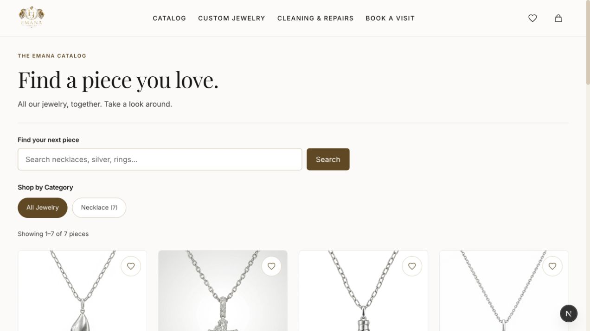
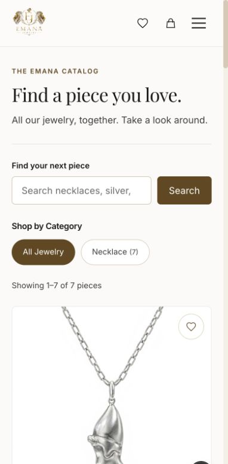
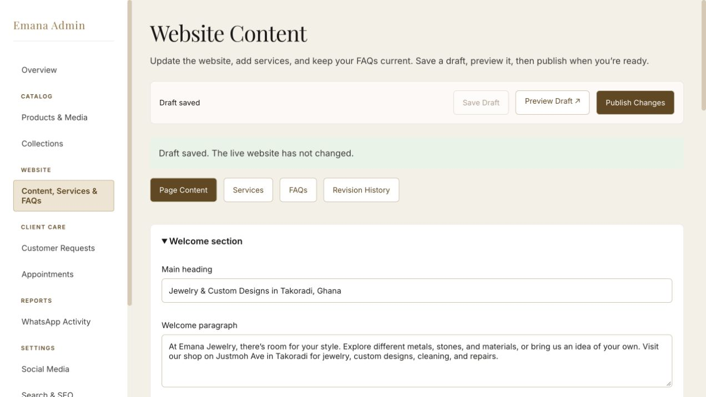

# Emana Jewelry

A catalog and inquiry website for a jewelry shop in Takoradi, Ghana. Customers browse products and contact the owner for availability and pricing. There is no online payment flow or customer account system.

## What it does

- Search and filter the catalog by collection, with pagination.
- View product photos, swipe between images on mobile, and optionally watch a product's YouTube video.
- Choose Gold or Silver on product pages; staff control the offered choices for each piece.
- Send a WhatsApp price enquiry with the product name and link, or submit a quote list.
- Request an appointment for custom jewelry, cleaning, or repairs.
- Save favorites and recently viewed products in the browser without signing up.
- Manage products, collections, inquiries, appointments, search verification, and social links in a staff-only admin.
- Edit main website copy and images, add services and FAQs, preview drafts, publish, and restore revisions through the custom CMS.

## Screenshots

Desktop catalog:



<details>
<summary>Phone layout</summary>



</details>

<details>
<summary>Content and services editor</summary>



</details>

Screenshots show local catalog data. See the deployment notes below for moving product data and images to a live environment.

## Stack and structure

Next.js 16 App Router, React 19, TypeScript, CSS Modules, Prisma 7, and MySQL. Remotion renders the homepage slideshow. Production image uploads use Supabase Storage; optional notification emails use Resend. Vitest and Testing Library cover application logic and selected UI workflows.

```text
src/app/          Pages, route handlers, and server actions
src/components/   Storefront and admin components
src/lib/          Validation, authentication, data access, and shared logic
prisma/           Database schema, migrations, and optional sample seed
scripts/          Local setup utilities
tests/            Unit and component tests
docs/             Architecture and operating notes
```

PostgreSQL-to-MySQL transfer and rollback instructions: [MySQL migration](docs/MYSQL-MIGRATION.md). The archived PostgreSQL schema and migration history are retained under `prisma/postgresql/`.

Read [Architecture](docs/ARCHITECTURE.md) for the reasons behind the main choices and their limits.

## Run locally

Use Node.js 24 (or a supported Node 20.19+/22.12+ release) and a running MySQL 8.0+ or MariaDB 10.6+ database. Create an empty database for this project; do not reuse a database with unrelated tables.

```sh
npm ci
cp .env.example .env
```

Fill in `DATABASE_URL`, `ADMIN_EMAIL`, and `SESSION_SECRET` in `.env`. Generate the session secret with `openssl rand -hex 32`. Run the following command to generate a random admin password and its hash:

```sh
npm run admin:credentials
```

Keep the password in a password manager and copy the printed `ADMIN_PASSWORD_HASH` into `.env`. The command generates values only; it does not edit `.env` or change an existing account. Restart the app after changing configuration.

```sh
npx prisma generate
npx prisma migrate deploy
npm run dev
```

Open [the storefront](http://localhost:3000) or [admin login](http://localhost:3000/admin/login). An empty database starts without products; add collections and products in the admin. The optional `prisma/seed.ts` is destructive sample-data tooling: it deletes existing products, collections, reviews, and appointments. Do not run it against a real shop database.

Local uploads live in `.data/product-images`. Keep that folder alongside your local database backup. Environment files, databases, and local uploads are excluded from Git. The checked-in `.env.example` contains no live credentials.

## Checks

```sh
npm run lint
npm run typecheck
npm test
npm run build
```

GitHub Actions runs lint, TypeScript, tests, and a production build with a temporary MySQL service. Component tests mock external integrations; they do not prove that production email, cloud storage, or WhatsApp delivery works. See [Verification](docs/VERIFICATION.md) for the manual checks.

## Deployment and current limits

Apply migrations to a persistent MySQL database and configure production environment variables before starting the app. Use `npm run build` and `npm start` for a Node deployment that supports Next.js server features.

- Production uploads require a public Supabase `product-images` bucket. Update `images.remotePatterns` in `next.config.ts` to match your storage hostname. The current allowlist is project-specific.
- Local product rows and uploaded photos do not transfer through GitHub. Move images to durable storage and update their URLs before migrating catalog data. Local `/media/products/...` URLs return 404 in production.
- Search verification and social links use local files in development and database records in production. Configure the live values through the admin.
- Admin authentication currently uses one configured staff account. Separate staff accounts, roles, shared rate limiting, monitoring, and backup automation remain launch work.
- Email is best-effort after a request is saved, without a durable retry queue. Sender and recipient details currently belong to Emana; changing them requires a code/configuration review.
- Some collection/product routes retain sample-data fallbacks when database queries fail. The full catalog and admin do not provide an offline production database replacement.
- Payment processing and customer accounts are outside the current scope.

Image optimisation details and regeneration steps: [Homepage performance](docs/HOMEPAGE-PERFORMANCE.md).

Product option setup: [Gold and Silver choices](docs/PRODUCT-OPTIONS.md).

CMS guide: [Website content management](docs/CONTENT-MANAGEMENT.md).

Further notes: [Backend operations](docs/BACKEND-OPERATIONS.md), [Product media](docs/PRODUCT-MEDIA.md), [Customer browsing](docs/CUSTOMER-BROWSING.md), and [Search visibility](docs/SEARCH-VISIBILITY.md).

## Development approach

AI coding tools assisted implementation. Changes still need human review and verification against the shop's requirements. `AGENTS.md` records the repository's Next.js guidance; `CLAUDE.md` points to the same instructions. These files are tooling context, not application dependencies.

The repository began with a Create Next App commit followed by an import of the working application. Subsequent maintenance uses focused commits; the original history is retained.
